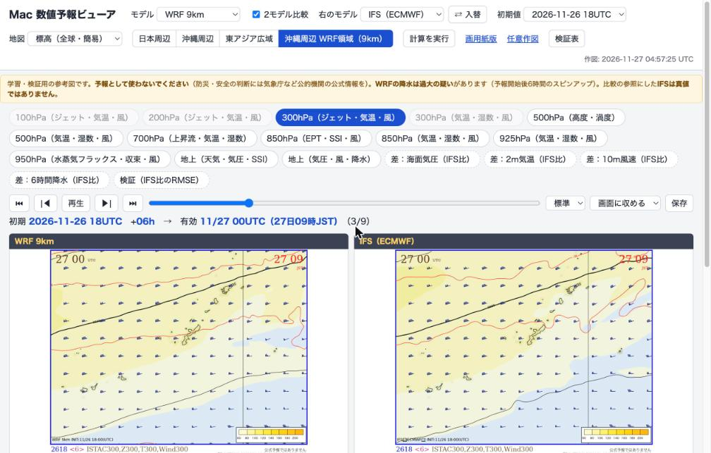
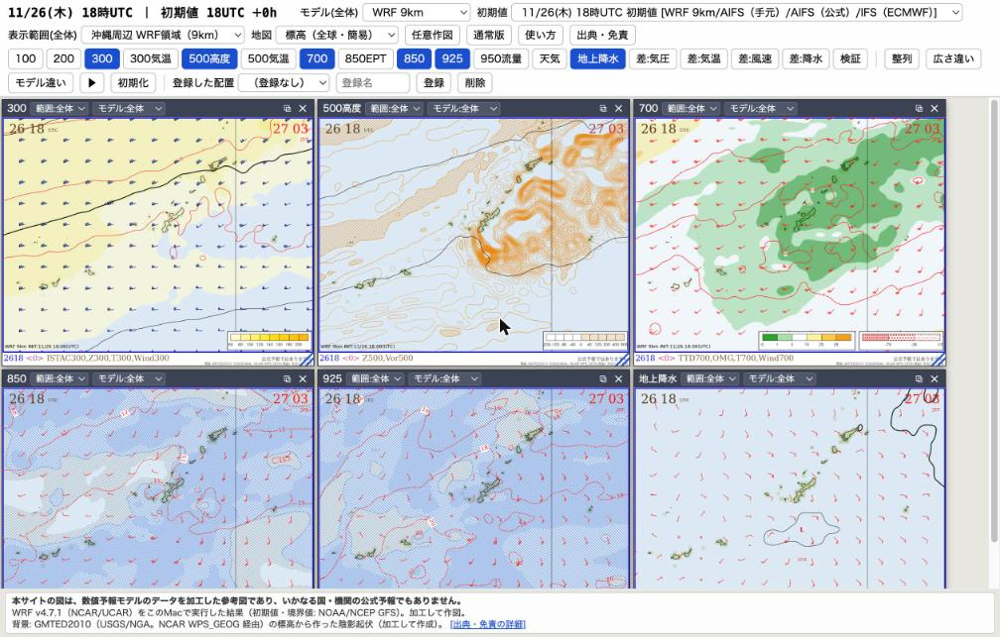
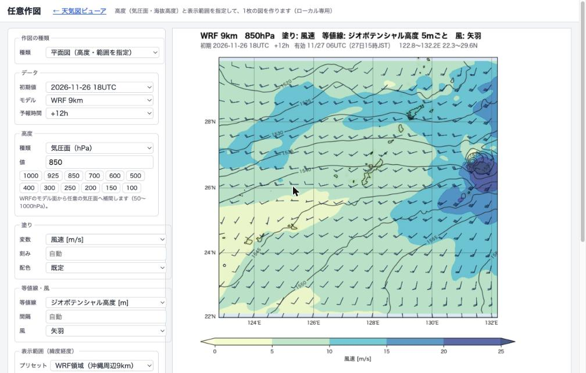
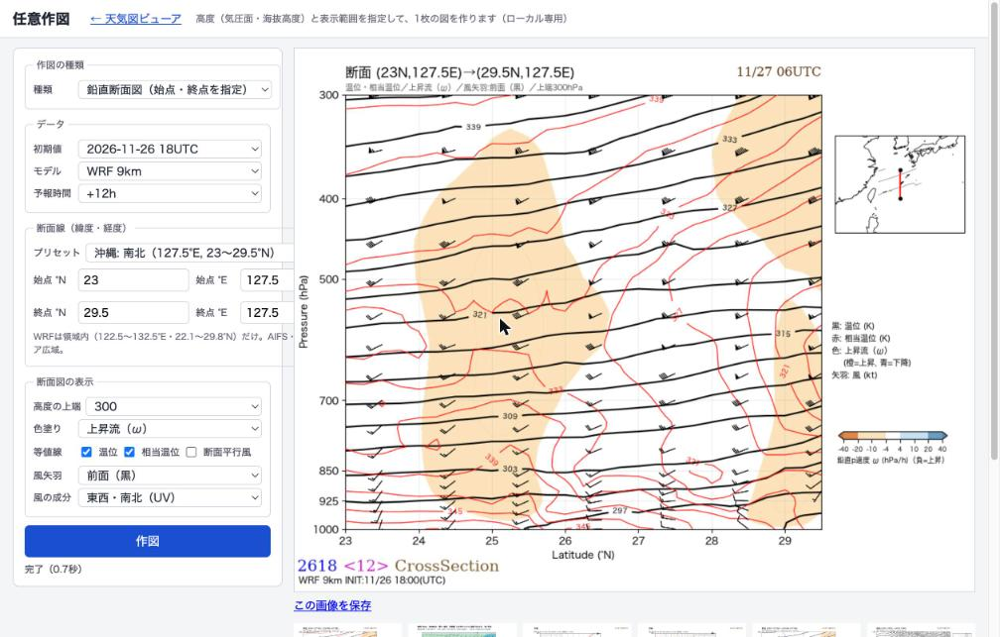
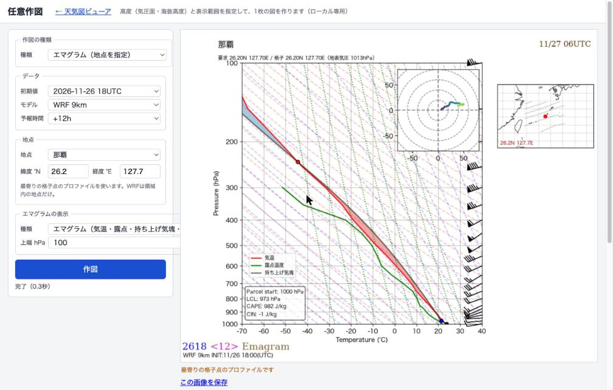
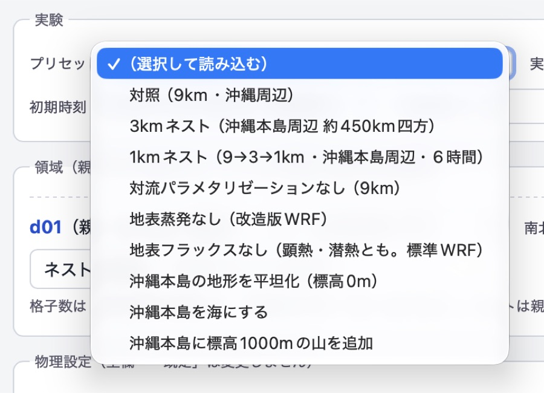

# mac_wx_lab 利用ガイド — モデル諸元・データ・実行時間・使い方

MacBook（Apple M5 Pro・メモリ64GB）で、気象の**物理モデル（WRF）**と**AIモデル（AIFS）**を動かし、天気図で比べるためのまとめです。測定値は 2026-11-27 時点の実測です。

- 公開サイト（閲覧専用）: <https://masauehr.github.io/mac_wx_lab/>
- ライセンス: コードは MIT。データ・モデルの出典と条件は [NOTICE.md](../NOTICE.md)
- 作業の経緯・つまずき: [phase1_log](phase1_log.md)（AIFS）・[phase2_log](phase2_log.md)（WRF）・[phase3_log](phase3_log.md)（比較・Webアプリ・公開）

## 1. 全体の流れ

```
 取得（インターネット）                  計算（このMac）                      表示
 ┌──────────────────────┐   ┌───────────────────────────┐   ┌──────────────────────┐
 │ ECMWF オープンデータ │──▶│ AIFS（AI予報・CPU）           │──▶│ 天気図ビューア         │
 │  （IFS・AIFS公式）   │   │  初期値 = ECMWF               │   │ 画用紙版              │
 │ NOAA GFS（AWS）      │──▶│ WRF（物理モデル・6並列）      │──▶│ 任意作図（ローカル）   │
 │ NCAR WPS_GEOG（地形）│   │  初期値・境界値 = GFS         │   │ 検証表（IFS比）        │
 └──────────────────────┘   └───────────────────────────┘   └──────────────────────┘
```

画面の「計算を実行」で、初期時刻を選ぶと「参照データ取得 → GFS取得 → AIFS → WRF → 作図」が順に走ります。済みの段階は自動でスキップします。

## 2. モデルの諸元

### 2.1 WRF（物理モデル・領域モデル）

NCAR/UCAR の WRF v4.7.1（ARW）。前処理は WPS v4.7.0。パブリックドメイン。

| 項目 | 設定 |
|---|---|
| 領域 | 沖縄周辺。中心 26°N・127.5°E、ランベルト正角円錐図法（標準緯線 26°N）。約 122.5〜132.5°E・22.1〜29.8°N |
| 水平格子 | **9 km**、121 × 101 点（約 1080 × 900 km）。ネストなし（単一領域） |
| 鉛直 | **45層**（ハイブリッド座標 `hybrid_opt=2`）、上端 50 hPa |
| 時間刻み | 54 秒（24時間で1600ステップ）。出力は1時間ごと |
| 雲物理 | WSM6（`mp_physics=6`） |
| 積雲 | Kain-Fritsch（`cu_physics=1`）、5分ごと |
| 長波・短波放射 | RRTMG（`ra_lw_physics=4`・`ra_sw_physics=4`）、9分ごと |
| 境界層 | YSU（`bl_pbl_physics=1`） |
| 接地層 | 改良MM5（Monin-Obukhov。`sf_sfclay_physics=1`） |
| 地表（陸面） | Noah LSM（`sf_surface_physics=2`）、土壌4層 |
| 力学・拡散 | 非静力学。水平拡散は2D Smagorinsky（`diff_opt=1`・`km_opt=4`）、鉛直 w 減衰、上端ダンピング（`damp_opt=3`・`zdamp=5000`）、重力波抵抗（`gwd_opt=1`） |
| 地形・土地利用 | WPS_GEOG **低解像度**（標高 GMTED2010 5分≒9km、土地利用 MODIS 20分類 5分）。9km格子には十分だが、3km以下には粗い |
| 側面境界 | 緩和帯5点、3時間ごとの GFS 予報で更新 |
| 並列 | MPI（dmpar）6プロセス。ビルドは gfortran / clang（conda-forge で隔離） |

**注意**: 降水が過大です（予報開始後6時間のスピンアップ。領域平均で IFS 比 +35%、最大は約2倍）。原因の切り分けは未了です。

### 2.2 AIFS（AI予報モデル・全球）

ECMWF の AIFS Single v1.0（機械学習による決定論予報）。学習済みの重みは CC BY 4.0。

| 項目 | 内容 |
|---|---|
| 方式 | **エンコーダ・プロセッサ・デコーダ**。グラフニューラルネットワーク（GNN）で入力格子から内部の粗い格子（約4万点）へ写し、**スライディングウィンドウ型 Transformer**（窓 ±1120点・16ヘッド×64次元）で時間発展させ、再び出力格子へ戻す |
| 出力格子 | **N320 縮約ガウス格子**（約 31 km、542,080 点）。公開データは 0.25° に補間 |
| 鉛直 | 気圧面 **13面**（1000・925・850・700・600・500・400・300・250・200・150・100・50 hPa）。950hPa面は無い |
| 時間刻み | **6時間**。入力は「6時間前と現在」の2時刻、1ステップで6時間先を出す自己回帰（24時間は4ステップ） |
| 入力変数 | 各面の ジオポテンシャル・気温・風（東西・南北）・鉛直速度・比湿、地上の 気圧・海面気圧・地表温度・2m気温・2m露点・10m風・可降水量、土壌水分・土壌温度（2層）、固定量（陸海・標高・地形の傾き・ばらつき）、日射・緯度経度・時刻 |
| 出力変数 | 上記に加え、降水・対流降水・雲量（全・高・中・下層）・下向き日射・下向き長波・降雪・100m風・流出など |
| 学習 | ERA5（1979〜2022）で事前学習 → ECMWF の運用解析（2016〜2022）で微調整。損失は面積重み付きの平均二乗誤差 |
| 特有の性質 | 平均二乗誤差で学習しているため、**長時間の予報で場がぼやける**（平滑化）。台風などの強い現象の強度が弱めに出やすい。確率予報（アンサンブル）ではなく1本の予報 |
| このMacでの実行 | **CPU・fp32**（GPU の MPS は torch 2.4 で結果が実行ごとに変わり不安定）。重みの CUDA 専用 flash_attention は、PyTorch で書いた窓付きアテンションに置き換えて実行 |
| 境界値 | **不要**（全球モデルなので側面の境界がありません） |

### 2.3 比較の参照: IFS（ECMWF の物理モデル・全球）

ECMWF の高解像度予報（HRES）。オープンデータとして 0.25°・13気圧面で公開されたものを、**比較の参照**に使います（モデルの計算はしません）。IFS は真値ではありません。

## 3. 初期値と境界値

| モデル | 初期値 | 境界値 | 取得先 |
|---|---|---|---|
| **AIFS（手元）** | ECMWF の IFS 解析・短時間予報（6時間前と現在の2時刻、0.25°）を、AIFS の格子（N320）へ補間 | 不要（全球） | ECMWF オープンデータ（`ecmwf-opendata`） |
| **WRF** | NOAA/NCEP **GFS 0.25°** の初期時刻（f000）。気圧面（気温・風・相対湿度・高度）、地表気圧、海面気圧、2m・10m、土壌温度・水分（4層）、地表温度、陸海、海氷、積雪 | 同じ GFS の予報（**3時間ごと・24時間分**）を領域の側面に与える | NOAA の AWS 公開バケット（必要な変数だけバイト範囲指定で取得） |
| 静的データ（WRF） | ― | ― | NCAR WPS_GEOG 低解像度版（約150MB・地形・土地利用・土壌など） |

- WRF の初期値・境界値は **NCAR ではなく NOAA（GFS）** です。NCAR は WRF と WPS のプログラム、静的地理データを提供しています。
- 比較の参照（IFS・公式AIFS）も ECMWF のオープンデータです。

## 4. データ取得先と、過去データがあるか

| データ | 取得先 | 取れる期間（2026-11-27 に実測） |
|---|---|---|
| ECMWF IFS・AIFS（本家） | `data.ecmwf.int` | **直近約3日分のみ** |
| ECMWF IFS（AWSミラー） | AWS `ecmwf-forecasts` | 約 **2024-02-29** から（0.25°）。**土壌の変数は約 2024-11-12 から** |
| ECMWF AIFS 公式（AWSミラー） | 同上 | 約 **2025-02-26** から |
| NOAA GFS 0.25° | AWS `noaa-gfs-bdp-pds` | 約 **2021-03-23** から |
| NCAR WPS_GEOG | `www2.mmm.ucar.edu` | 固定の静的データ |

アプリは、本家にある日付は本家から、無い日付は AWS ミラーから**自動で切り替えて**取得します。AIFS（手元）は、初期値に IFS のオープンデータを使い、**入力に土壌の変数（土壌水分・土壌温度）が要る**ため、土壌の変数が公開された **2024-11-12 以降**で計算できます（それ以前は IFS のデータに土壌の変数がなく、実行に失敗します）。WRF は GFS を使うため 2021-03-23 以降で計算できます。公式 AIFS が無い期間は、ほかのモデルだけで作図します。

## 5. 取得できる初期時刻

- 初期時刻は **00・06・12・18 UTC**（日本時間の 09・15・21・03 時）の4回です。それ以外の時刻は元データにありません。
- 公開までの遅れの目安（nwp_chart_web の実測。72時間分が揃う時刻。24時間分はもっと早い）: GFS は約4〜6時間後、AIFS 公式は約5〜7時間後、IFS は約7〜10時間後（00Z・12Z とも同様）。
- 実際に、2026-11-27 04UTC 時点の最新は 2026-11-26 18UTC でした。
- 未来の時刻や、取得できる期間より前の時刻を選ぶと、画面が理由を表示して拒否します。

## 6. 実行時間と容量（実測）

| 段階 | 時間 | 備考 |
|---|---|---|
| AIFS 初期値の取得・補間 | 初回 約4〜5分、2回目以降は数秒 | `data/` にキャッシュ。約0.8GB |
| AIFS 24時間予報（CPU） | **約3.7〜4.5分**（224〜272秒） | メモリ 約50〜56GB（他の重い作業は止める） |
| 参照データ（IFS・公式AIFS）取得 | 数分〜10分 | 約0.4GB。AWSミラーは混雑時に再試行で長引く |
| GFS 取得（WRF用） | **約35分** | 9ファイル×約130MB。レコードごとの範囲取得のため遅い |
| WPS（geogrid・ungrib・metgrid）・real | 合計 1分未満 | |
| WRF 24時間予報（6並列） | **約7分**（417秒） | 出力 約0.38GB。理想実験（スーパーセル2時間）は約10秒 |
| 作図 | 背景1種で約10分、3種で約25〜30分 | 6並列。1初期時刻で約800コマ（背景地図の数だけ画像が増える） |
| 任意作図 | 平面図 約1〜2秒（初回のデータ読込のみ約10秒）、断面図・エマグラム 1秒未満 | |
| ビルド（初回のみ） | WRF 約30〜60分（理想実験用と実事例用で各1回）、WPS 数分 | |

1初期時刻あたりの容量の目安: GFS 約1.2GB、参照 約0.4GB、AIFS 入力 約0.8GB・出力 約0.3GB、WRF 出力 約0.4GB、図 約0.2〜0.5GB（背景1種あたり）。

## 7. 使い方

### 7.1 起動

```bash
bash webapp/start.sh        # → http://127.0.0.1:8795/ （この Mac からだけ開ける）
```

### 7.2 天気図ビューア（通常版）



- **モデル**・**初期値**・**地図（背景）**・**地域**（日本周辺・沖縄周辺・東アジア広域・WRF領域）を選びます。
- 図種タブは nwp_chart_web と同じです（高層→地上）。降水は「地上（気圧・風・降水）」と「地上（天気・気圧・SSI）」に、**RR3・RR1**（直前3時間・1時間の降水強度）があります。作れない組み合わせは淡色表示です。
- 末尾（破線）は比較用の図: IFS比の差分（気圧・気温・風速・6時間降水）と、検証（IFS比のRMSE）。
- **2モデル比較**にチェックを入れると、同じ図を左右に並べます。選んだモデルは勝手に変わりません。データが無い地域では「画像なし」と表示します。WRF は広い地域でも、データのある範囲（赤の破線の枠）だけ描き、周りは背景地図のみです。
- ←→ 予報時間、↑↓ 図種、Space 再生、C 比較の切り替え。**検証表**で IFS 比の偏差・RMSE・相関を見られます。

降水の時間幅で選べるもの:

| モデル | 選べる降水 | 理由 |
|---|---|---|
| WRF | RR1・RR3・RR6 | 1時間ごとに出力 |
| IFS | RR3・RR6 | 元データが3時間間隔（1時間はなし） |
| AIFS（手元・公式） | RR6 のみ | モデルの時間刻みが6時間 |

### 7.3 画用紙版



複数の図を自由に並べる画面です（通常版のヘッダーの「画用紙版」、または `/board/`。公開サイトにもあります）。

- 上部の図種ボタンで表示する図のON/OFF、**整列**で敷き詰め、タイトル帯のドラッグで移動、右下のドラッグで拡大縮小。
- **モデル違い**: 選んだ図を、ほかのモデルでも同じ範囲で並べる。**広さ違い**: 選んだ図を、ほかの全地域でも並べる。各図の「範囲」「モデル」欄で、図ごとに変えられます。
- ↑↓ で全図の予報時間を同時に進め、←→ で初期時刻を切り替えます。配置は名前を付けて**登録**できます。

### 7.4 任意作図（ローカル専用）

通常版ヘッダーの「任意作図」（`/custom.html`）。モデル・初期値・予報時間を選び、**作図の種類**を3つから選びます。「作図」ボタン（または Enter）で、1〜2秒で1枚できます。下の履歴から条件を呼び出せます。

#### 平面図（高度と範囲を指定）



| 項目 | 内容 |
|---|---|
| 高度 | **気圧面 hPa**（50〜1000の連続値。WRF はモデル面から直接補間。AIFS・IFS は13面の間を log p で補間し、図に注記）、**海抜高度 m**（WRF のみ）、**地上**（2m気温・海面気圧・10m風速・降水強度・全雲量） |
| 塗り | 変数（気温・高度・風速・相対湿度・湿数・渦度・発散・鉛直p速度ω・混合比・相当温位・温位）、刻み、配色 |
| 等値線 | 変数と間隔（空欄は自動） |
| 風 | 矢羽・矢印・なし |
| 表示範囲 | 西端・東端・南端・北端の数値入力、またはプリセット（日本周辺・沖縄周辺・九州・関東・東アジア広域・WRF領域・台湾周辺・南西諸島）。メルカトル図法 |
| 降水の幅（地上） | 6時間平均・3時間平均（WRF・IFS）・1時間（WRFのみ） |
| 背景地図 | 標高の陰影（全球）・国土地理院の淡色地図・色別標高図・陰影起伏図・標準地図・なし |

#### 鉛直断面図（始点・終点を指定）



始点と終点の緯度経度を入力（プリセットあり）し、**高度の上端**（100〜700hPa）、**色塗り**（湿り・上昇流ω・発散・なし）、**等値線**（温位・相当温位・断面平行風）、**風矢羽**（前面・背景・なし）、**風の成分**（東西南北／断面平行・垂直）を選びます。WRF は領域内だけです。

#### エマグラム（地点を指定）



地点（那覇・石垣島・東京など、または任意の緯度経度）と**上端**を選びます。**エマグラム**（気温・露点・持ち上げ気塊・CAPE・CIN・LCL・ホドグラフ）と、**温位エマグラム**（横軸が温位。θ・θe・θes）を切り替えられます。最寄りの格子点のプロファイルを使います。

### 7.5 計算の実行

ヘッダーの「**計算を実行**」。初期時刻（候補、または日付と時刻の指定）、モデル（AIFS・WRF）、背景地図（複数可）を選んで「実行」。進行表示とログが出ます。「作図だけやり直す」「中止」もあります。計算は1ジョブずつです（AIFS がメモリ約55GBを使うため）。

## 8. 制限と注意

- **予報として使わない**でください（学習・検証用）。防災・安全の判断には気象庁など公的機関の公式情報を使ってください。
- WRF の降水は過大の疑いがあります。比較の参照にした IFS は真値ではありません（解析値・アメダス実況での検証は未了）。
- **国土地理院タイル**を背景にした図は、ローカル版だけです。加工した画像の再配布の可否が規約から判断できないため、公開サイトには載せていません（公開サイトの背景は GMTED2010 の標高から作った陰影）。詳細は [NOTICE.md](../NOTICE.md)。
- 任意作図の AIFS・IFS は提供13面の間を補間します。950hPa 水蒸気フラックスは WRF だけです。
- 規約は変わり得ます。公開を続ける間は、配信元で定期的に確認してください。

## 9. 起動に必要なもの（参考）

- Python 3.11（`uv venv`）、conda-forge の gfortran・netCDF-Fortran・MPICH（WRF のビルド用）。手順は `physics/build_wrf.sh`、実行は `physics/run_case.sh`。
- AIFS: `anemoi-inference` 0.4.9・`anemoi-models` 0.3.1・`torch` 2.4.0（重みの学習時の版に合わせる必要があります）。

## 10. WRF 実験（領域・格子・物理設定・地形を変えた計算）

通常版ヘッダーの「WRF実験」（`/wrf.html`、ローカル専用）で、設定を決めて実行します。結果は別のモデルとして、天気図・画用紙版・任意作図（断面図・エマグラム）に並びます。領域が対照と同じ実験は、「実験−対照」の差分図（海面気圧・気温・風速・6時間降水・積算降水）も出ます。

### 感度実験の画面と操作

画面は `http://127.0.0.1:8795/wrf.html`（`bash webapp/start.sh` で起動。通常版ヘッダーの「WRF実験」からも開く）。**自分の Mac からしか開けず、公開サイトには載せていません。** 設定ファイルを編集する必要はなく、フォームで決めて実行します。


| 場所 | 内容 |
|---|---|
| **実験**（左上） | プリセット、実験ID（英数字1〜16文字。結果のモデル名 `x_<ID>_d01` に使う）、表示名、初期時刻（過去も可）、予報時間、出力間隔 |
| **領域** | d01（親）の格子間隔・格子数・中心の緯度経度。「ネストを追加」で d02・d03（親の 1/3 か 1/5）を足す。領域の大きさ（km）が右に出る |
| **物理設定** | 雲物理・積雲・境界層・接地層・陸面・放射・地表フラックスなど。**「既定」は変更しない**。領域が複数あれば領域ごとに選ぶ。下の2行（蒸発・顕熱の係数）は**改造版WRF**を使う |
| **地形・陸海の編集**（さらに下） | 地形の倍率、標高を指定、陸を海にする、山を追加（範囲は緯度経度） |
| **見積りと検査**（右上） | 設定を変えるたびに、計算時間・メモリ・各領域の時間刻みを表示。不正な設定（ネストの置き方、物理の組み合わせなど）は赤字で理由を出す |
| **実行**（右） | 背景地図を選んで「この設定で実行」。段階（参照データ取得 → GFS取得 → AIFS → WRF → 作図）の進行とログを表示。「中止」で止められる。計算は1ジョブずつで、**他のジョブの実行中は待機する**（画像は、台風の過去事例を取得中に開いた例） |

#### プリセット

「プリセット」から選ぶと、設定がフォームに読み込まれます（そのまま実行も、変更してから実行もできます）。



| プリセット | 変えるもの | 見方 |
|---|---|---|
| 対照（9km・沖縄周辺） | なし | 比較の基準。ここから設定を1つずつ変える |
| 3kmネスト（沖縄本島周辺 約450km四方） | 領域: 親9km＋ネスト3km（151×151） | 格子を細かくすると、降水・地形の効果がどう変わるか（約45分） |
| 1kmネスト（9→3→1km・6時間） | 領域: 3段のネスト | さらに細かい格子（6時間で約50分） |
| 対流パラメタリゼーションなし（9km） | `cu_physics=0` | 積雲スキームの寄与（雨を陽に解像すると降水帯がどう変わるか） |
| 地表蒸発なし（改造版WRF） | `qfx_scale=0` | 地表からの水蒸気供給の寄与（降水が約3分の1減る） |
| 地表フラックスなし（顕熱・潜熱とも。標準WRF） | `isfflx=0` | 地表の加熱・加湿を全て止めたときの影響（蒸発だけを止めるのとは別） |
| 沖縄本島の地形を平坦化（標高0m） | 地形: 標高0m | 地形の強制（山による上昇流）の寄与 |
| 沖縄本島を海にする | 地形・陸海: 陸→海 | 島の存在（陸面の加熱・摩擦）の寄与 |
| 沖縄本島に標高1000mの山を追加 | 地形: 山を追加 | 山があったらどうなるか |

#### 実験の手順

1. プリセットを選ぶ（または各項目を変える）。実験IDは、ほかの実験と重ならない名前にする（`ctl` は対照用で使えない）。
2. 右上の見積りを確認する。長くなる設定（1km・500m など）は、予報時間や領域を小さくする。
3. 「この設定で実行」。他のジョブが動いていれば、終わるまで待機する。
4. 完了後、通常版の「モデル」に **WRF <表示名> d01** が並ぶ。対照と並べて（2モデル比較）見るほか、図種の末尾に「**実験−対照**」の差分図（海面気圧・気温・風速・6時間降水・積算降水）が出る。領域が対照と違う実験（ネスト）は、専用の地域が増える。
5. 「実験の設定」ボタンで、その実験の領域・物理設定・地形編集を確認できる。公開するときは「公開サイトへ反映」で、感度実験の図（WRF領域と実験の領域）が公開サイトに載る。

### 設定できるもの

| 項目 | 内容 |
|---|---|
| **領域・格子** | 親（d01）＋ネスト最大2つ（d02・d03）。中心の緯度経度、格子間隔、格子数を指定。ランベルト図法。ネストは親の格子間隔の **1/3 か 1/5**、格子数は倍率の倍数＋1（例: 151・181・241）。親の端から5格子以上内側に置く |
| **格子間隔の下限** | 500m。**9km → 500m は直接つなげない**ため、**7.5km → 1.5km（1/5）→ 500m（1/3）** や 4.5km → 1.5km → 500m にする。時間刻みは自動（親は 6×格子間隔[km] 秒） |
| **物理設定** | 雲物理・**積雲（なし＝陽に解像）**・境界層・接地層・陸面・長波/短波放射・拡散/乱流混合・放射と積雲の呼び出し間隔・地表フラックス・鉛直層数・上端気圧。領域ごとに指定。非対応の値や矛盾する組み合わせは理由つきで拒否 |
| **地表フラックス** | 標準の `isfflx=0` は顕熱・潜熱を**両方**止める。**蒸発（水蒸気フラックス）だけ**、または顕熱だけを 0〜1 倍にするには、**改造版WRF**（`qfx_scale`・`hfx_scale`）を使う |
| **地形・陸海の編集** | geogrid の出力（`geo_em`）を編集してから実行: **倍率**（例 0.5倍）、**標高を指定**（平坦化）、**陸を海にする**（地形0m・陸海マスク・土地利用・土壌を水に変える近似）、**山を追加**（ガウス型）。範囲は緯度経度の矩形（空欄は全域）。全領域に同じ編集を適用 |
| 実行条件 | 初期時刻（過去も可）、予報時間 1〜72時間、出力間隔（分） |

プリセット: 3kmネスト（沖縄本島周辺 約450km四方）、1kmネスト（9→3→1km・6時間）、積雲なし、蒸発なし（改造版）、地表フラックスなし、沖縄本島の地形を平坦化・島を海にする・山を追加。

### 改造版WRF（蒸発・顕熱の係数）

標準の WRF は無改造のまま、`physics/WRF_exp/` にコピーして Registry に `qfx_scale`・`hfx_scale` を追加し、`dyn_em/module_first_rk_step_part1.F` で、境界層スキームに渡す直前に `qfx`・`hfx` に係数を掛ける改造を入れてビルドしたものです（約30分）。係数が1の既定では何も変わりません。陸面モデル側の水収支は変えないため、「大気への蒸発だけを止める」感度実験として扱ってください。

### 計算時間の見積り

実測（121×101・24時間＝417秒）から、1格子点・1ステップあたり約21マイクロ秒で見積もります。実行前に、フォームの右側に計算時間とメモリを表示します（他のジョブと同時だと遅くなります）。

| 設定の例 | 目安 |
|---|---|
| 対照（9km・121×101・24時間） | 約7分 |
| 3kmネスト（親9km＋151×151・24時間） | 約45分 |
| 9→3→1km（181×181・6時間） | 約50分 |
| 7.5→1.5→0.5km（500m は 181×181＝90km四方・6時間） | 約2時間（24時間なら約8時間） |
| 500m を 361×361（180km四方）・24時間 | 約24時間 |

メモリは 7〜13GB で収まります。**時間が現実的な制約**です。

### 実験の例（2026-11-26 18UTC の初期値・9km・24時間）

対照と同じ領域（121×101）で、1つだけ設定を変えた結果です。領域内の24時間積算降水（mm）:

| 実験 | 変更点 | 領域平均 | 最大 | 見方 |
|---|---|---|---|---|
| **対照** | なし | 12.5 | 214.8 | |
| 積雲なし | `cu_physics=0` | 9.1（−28%） | 254.7（+19%） | 降水帯の位置と強さが変わる（最大±60mm）。降水が陽に解像されるぶん強い所は強くなる |
| 蒸発なし（改造版） | `qfx_scale=0` | **8.2（−35%）** | 180.1（−16%） | 地表蒸発が止まり（QFX=0を確認）、降水が約3分の1減る。対照の降水過大の一因が地表からの水蒸気供給にある可能性 |
| 島なし | 沖縄本島（15格子）を海に | 12.5（ほぼ同じ） | 214.8 | この事例の降水は総観規模の前線が主で、島の有無の影響は小さい |

### 注意

- 地形データは30秒格子（約900m）まで。**500m 格子では補間になり、地形の細かさは増えません**（より細かい地形には SRTM 3秒などの追加データが必要）。
- 初期値の GFS は約28km。細かい格子には**数時間のスピンアップ**が必要で、最初の数時間は割り引いて見てください。500m〜1km は境界層スキームと乱流の扱いが難しい帯域です（LES風の設定: 境界層なし＋3次元TKE拡散も選べます）。
- ネスト領域は、親へ影響を返さない（`feedback=0`）一方向のネストです。対照との比較のため、親（d01）の結果が実験で変わらないようにしています。

## 11. ディスク使用量

2026-11-27 夕の実測です（このプロジェクト全体で **約 58GB**。ディスクは 926GB 中、空き 133GB・使用率 86%）。

| 場所 | 容量 | 内容 | 増え方・減らし方 |
|---|---|---|---|
| `physics/cases/` | **28GB** | WRF の実行ごとの作業ディレクトリ（対照＋実験3ケース。各 約7GB） | 実験ごとに約7GB。大半は **WPS の中間ファイル `GFS:*`（1ケース約6.6GB）**。metgrid の後は不要で、消しても結果（`wrfout`）に影響しない |
| `data/geog_dl/` | 20GB | NCAR WPS_GEOG（低解像度 1.5GB＋高解像度 16GB＋圧縮ファイル 2.7GB） | 高解像度版は 3km 以下の領域に必要（うち `greenfrac_fpar_modis` が10GB）。圧縮ファイル（2.7GB）は展開済みなので不要 |
| `data/`（その他） | 約 3GB | GFS 1.1GB（1初期時刻）、AIFS 入力キャッシュ 0.8GB×初期時刻、参照データ（IFS・公式AIFS）約0.4GB×初期時刻 | 初期時刻ごとに約 2.5GB（取得し直せる） |
| `webapp/output/` | 1.7GB | 作図した天気図（背景地図ごと。標高陰影のみで 約 0.7GB） | 初期時刻・背景地図の数に比例 |
| `webapp/_site/` | 0.26GB | 公開サイトの生成物 | 公開のたびに作り直し |
| `.venv` / `.conda` | 各 0.9GB | Python 環境 / WRF ビルド用の依存 | 固定 |
| `physics/WRF` / `WRF_exp` | 0.8GB / 0.65GB | WRF 本体（標準・改造版） | 固定 |
| `runs/` | 0.6GB | AIFS の出力と、WRF 出力へのリンク | 初期時刻ごとに約 0.3GB |
| `outputs/` | 0.27GB | 試験用の画像など | 削除してよい |
| `.git` | 3MB | リポジトリ（大きなデータは `.gitignore` で除外） | |

**1初期時刻（対照＋AIFS）あたり**: GFS 約1.1GB、参照約0.4GB、AIFS 入力 0.8GB・出力 0.3GB、WRF 出力 0.4GB＋作業ディレクトリ約7GB、図 約0.7GB（標高陰影のみ）。**WRF 実験1つあたり**: 作業ディレクトリ約7GB＋出力 0.4GB＋図 約0.15GB。

**WPS の中間ファイル `GFS:*`（実験1つあたり約6.6GB）は、実行時に自動で消します**（`physics/wrfcase.py` と `physics/run_case.sh`。metgrid の後に削除）。画像表示・任意作図・断面図・エマグラムは使いません（使うのは `wrfout`）。残したいときは、設定に `"keep_intermediate": true` を入れます。`wrfout` は `physics/cases/<ケース>/` の中にあり、`runs/` はそこへのリンクなので、**ケースのフォルダごとは消さないでください**（`met_em*`・`wrfinput`・`wrfbdy` は小さく、WRF の再実行にだけ必要）。

**既存のケースの中間ファイルを消す**には、まず一覧を見て、確認してから削除します。

```bash
.venv/bin/python physics/wrfcase.py clean            # 一覧だけ（削除しない）。2026-11-27時点で合計 27.7GB
.venv/bin/python physics/wrfcase.py clean --apply    # 削除する
```

**そのほかの減らす候補**（未実施）: WPS_GEOG の圧縮ファイル（2.7GB・展開済みなので不要）、`outputs/`（0.27GB）。

## 12. 公開（感度実験・任意作図の図を公開サイトへ）

通常版ヘッダーの「**公開サイトへ反映**」（ローカル専用）で、公開サイト（GitHub Pages）を更新できます。確認画面で初期時刻（容量が出ます）を選び、確認のうえ実行します。`gh-pages` へ強制 push するため、**インターネットに公開される**点に注意してください。

| 公開されるもの | 内容 |
|---|---|
| 天気図 | 選んだ初期時刻の、**標高の陰影**を背景にした図（国土地理院タイルの背景は公開しない） |
| **感度実験** | 実験もモデルとして並ぶ（領域が対照と同じなら「実験−対照」の差分図も）。容量のため、**WRF領域と各実験の領域の図だけ**を載せ、広域（日本周辺・沖縄周辺・東アジア）の図は載せない。通常版の「実験の設定」で、設定・地形編集を見られる |
| **任意作図のギャラリー** | 任意作図で作った図のうち、結果の下の「**公開サイトのギャラリーに載せる**」を選んだもの（平面図・断面図・エマグラム）。通常版の「ギャラリー」から見られる。**国土地理院タイルを背景にした平面図は選べない**（背景を「標高の陰影」か「なし」にして作り直す） |
| 画用紙版 | 実験も含めて並べられる |

容量の目安は全体で 900MB 以下（Pages は約1GB）。1初期時刻（実験3つを含む）で約 0.7GB、実験なしなら約 0.13GB です。多すぎるときは、反映する初期時刻を減らしてください。コマンドでも `python webapp/publish_static.py <初期時刻…>` で反映できます。
